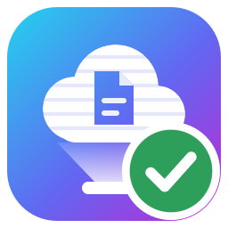
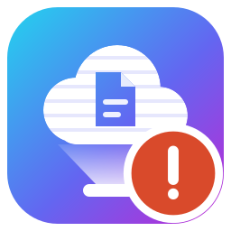

<p align="center">
  
</p>

<h1 align="center">holo-files</h1>

<p align="center">
  A fast OneDrive client for Windows with native <b>Files On-Demand</b>,<br>
  built to replace the official client without ever freezing Explorer.
</p>

<p align="center">
  <a href="https://github.com/HeyyCzer/holo-files/actions/workflows/ci.yml"></a>
  <a href="https://github.com/HeyyCzer/holo-files/releases/latest"></a>
  
  
</p>

---

## Why

- **Native placeholders** (Windows Cloud Filter API): files show up in Explorer, download only
  when opened, and Explorer gets *Always keep on this device* / *Free up space*.
- **Explorer never waits on the network.** Rename/delete callbacks are approved immediately and
  queued; folder listings come from placeholders created ahead of time from the delta feed.
- **Partial hydration** by byte range, with configurable read-ahead.
- **Dev-friendly defaults:** `node_modules/`, `.git/`, `target/`, `dist/`... are ignored in both
  directions, plus per-folder `.holoignore` files.
- **Files held open for writing** by another program (logs, databases) wait locally without
  touching the network.
- **Never overwrites silently:** conflicts become `name (conflict PC YYYY-MM-DD HHMMSS).ext`.
- **Adaptive parallel uploads** that back off on HTTP 429/503 and when you're using the PC.
- **Pluggable providers:** OneDrive is implemented; Google Drive is scaffolded.

## Download

Grab the latest build from [**Releases**](https://github.com/HeyyCzer/holo-files/releases/latest):

| File | Use it when |
|---|---|
| `holo-setup-<version>.exe` | **Recommended.** Per-user installer, no admin. Adds `holo` to your PATH, a Start menu entry, optional tray icon at logon, and handles upgrades. |
| `holo-<version>-windows-x64.zip` | **Portable.** Unzip anywhere; keep `holo.exe` and `holo-ui.exe` in the same folder. |
| `holo.exe` / `holo-ui.exe` | Bare executables (CLI / tray + status window). |

<details>
<summary>What the installer does</summary>

- Installs `holo.exe` and `holo-ui.exe` into `%LOCALAPPDATA%\Programs\holo`.
- Adds `holo` to the user PATH (open a new terminal).
- Adds **holo** to the Start menu (opens the status window and tray icon).
- Optional: shows the tray icon at Windows logon.

To upgrade, run the new installer over the old one. It closes the tray and stops the daemon
before replacing the executables, re-points the `holo service` logon task to the new location,
and restarts the daemon only if it was running. Uninstalling stops everything and asks whether
to also remove the Explorer folders and holo's data (default: no, so reinstalling picks up
where it left off).
</details>

## Quick start

1. **Register an app** in the Azure Portal (*Entra ID → App registrations → New registration*):
   - Supported accounts: *any organizational directory + personal Microsoft accounts*
   - Platform: *Mobile and desktop applications*, redirect URI `http://localhost`
   - *Allow public client flows*: **Yes**
   - Delegated permissions: `Files.ReadWrite`, `User.Read`, `offline_access`
2. Run `holo config` to see where `config.toml` lives, and put the *Application (client) ID*
   in `[onedrive].client_id`.
3. Sign in and add a folder:

```powershell
holo login                                                     # opens the browser
holo add-root D:\OneDrive\Test --remote /holo-test --create    # --create: create the remote folder (and parents)
holo run                                                       # foreground; Ctrl+C to stop
holo service install                                           # or: run in the background at logon
```

> Start with a **test folder** (`--remote /holo-test`), not your whole drive.

## Usage

```powershell
holo status                       # per-root status; --stream follows it live
holo ops                          # operation journal; `release` / `discard` after the mass-delete guard
holo ops --stream                 # live journal: + new, ~ changed, - done/discarded
holo pause | resume               # pause uploads and cloud reads (open-on-demand keeps working)
holo pin  D:\OneDrive\Test\video.mp4    # always keep on this device
holo free D:\OneDrive\Test\video.mp4    # free up space
holo service stop|start|status|uninstall   # stop = clean shutdown
holo remove-root D:\OneDrive\Test --yes
holo --help                       # everything else
```

### Tray and status window (`holo-ui`)

`holo-ui.exe` puts an icon in the system tray that reflects the overall state:

| | State |
|---|---|
|  | Up to date |
|  | Syncing |
|  | Paused |
|  | Needs attention (failures or held operations) |
|  | Daemon stopped |

The tooltip shows running uploads and queue size.

- **Click** opens the window: each root with items / queue / held / failed, cloud listing in
  progress (% / ETA), on-demand downloads with progress, running operations with elapsed time and
  workers, and the operation queue with a filter plus *Release held*, *Discard held* and
  *Retry failed*.
- **Right-click menu:** open folder, pause/resume, start/stop the daemon, logs, updates.
- *Start with Windows* (in the window) adds the tray icon to `HKCU\…\Run`.

**Updates.** The tray checks GitHub's latest release a minute after it starts, then every
`check_interval_hours`. For the installed version, it downloads `holo-setup-<version>.exe`,
checks its SHA-256 against the release's `SHA256SUMS.txt`, and offers *Install update vX.Y.Z*
in the menu. Installing runs the installer silently: it stops the daemon and the tray, replaces
the binaries and starts both again. Portable copies only get a link to the release page.

```toml
[update]
mode = "notify"            # "notify" (default), "auto" (install when nothing is syncing) or "off"
check_interval_hours = 24
```

With `"off"`, the menu item still checks on demand.

The UI only reads the same database as `holo status` and never syncs anything itself. Closing
the window or quitting the tray does not stop the daemon. The window is a separate process that
exists only while open; the tray icon alone uses ~17 MB.

### Dry run (`holo plan`)

Compares cloud × local folder × last sync and lists what would happen, with direction,
**without changing anything** (disk, database or cloud). It uses the same decision functions as
the real sync.

```powershell
holo plan D:\Holo --remote /      # before add-root: preview the first sync (cold start)
holo plan D:\Holo                 # existing root: changes since the last sync
holo plan D:\Holo --full          # existing root: full comparison
holo plan D:\Holo --no-hash       # don't read local files (faster; marked "unverified")
holo plan D:\Holo --json plan.json --show 0
```

Legend: `↓` cloud → PC, `↑` PC → cloud, `⇄` conflict (both sides), `·` no transfer now
(placeholder, link, move). The summary shows how much transfers now and how much stays available
on demand.

> In Git Bash use `MSYS_NO_PATHCONV=1` or PowerShell: Bash rewrites `--remote /` into `C:/Program Files/Git/`.

### Ignoring files (`.holoignore`)

`.gitignore` syntax, valid in any folder of a root: patterns are relative to the file's folder
and the deepest `.holoignore` wins. `./x` is accepted as `/x` (this folder only).

```gitignore
# Documents\Rockstar Games\Launcher\.holoignore
*.log
```

Creating, editing or deleting a `.holoignore` takes effect immediately (the daemon reloads it)
and drops pending uploads that became ignored. Items already uploaded stay in the cloud.

### Parallel uploads (`[sync].concurrency`)

```toml
[sync]
concurrency = "auto"   # or a fixed number
concurrency_min = 1
concurrency_max = 16
```

In `auto` mode the number of simultaneous uploads is re-evaluated every 2 s:

- **queue:** never more workers than pending operations;
- **PC usage:** no keyboard/mouse for 5 min → max; in use → half; in use with CPU ≥ 75% → min; on battery → half;
- **server:** HTTP 429/503 → halve and hold for 30 s.

It doubles until the first throttle, then +1 per cycle. `holo status --stream` shows the
current value and why.

## Data safety

- Remote deletions go to the OneDrive recycle bin; hydrated local content of items deleted
  remotely goes to `%LOCALAPPDATA%\holo\data\trash`.
- A file edited locally and deleted remotely is **re-uploaded as new**, never discarded.
- Deletions are re-checked before running (undoing a delete or a move doesn't delete remotely).
- More than `mass_delete_threshold` deletions per minute are **held** until `holo ops release`.
- Uploads use `If-Match` (eTag); if the remote changed, the local version becomes a conflict copy.
- The file's `USN` prevents marking a file as synced if it was edited during the upload.

## Architecture

```
crates/
  holo-core      model, CloudProvider trait, RelPath, ignore rules, Windows names, QuickXorHash
  holo-auth      generic OAuth 2.0 PKCE (loopback) + DPAPI-encrypted tokens
  holo-state     SQLite: accounts, roots, items (3-way base), ops (journal), kv
  holo-onedrive  Microsoft Graph: delta, ranged download, simple/session upload, retry/429
  holo-gdrive    Google Drive scaffold (OAuth ready, methods NotImplemented)
  holo-cfapi     Files On-Demand: sync root registration, placeholders, callbacks
  holo-engine    sync engine (provider- and filesystem-agnostic)
  holo-cli       `holo` binary (+ library used by the UI)
  holo-ui        `holo-ui` binary: tray icon + status window
```

```
cloud ── changes() ──► plan (pure fn) ──► apply to LocalTree ──► SQLite
Explorer ── CF callback ──► LocalEvent ──► debounce/classify ──► journal (ops) ──► executor ──► cloud
placeholder read ── fetch_data ──► ranged download ──► 4 KiB-aligned write
```

The engine touches the disk only through the `LocalTree` trait, so all of its logic (plan,
conflicts, uploads, deletions) is tested against an in-memory filesystem and a fake provider.

**Adding a provider** = implement `holo_core::CloudProvider` and register it in
`holo-cli/src/providers.rs`. Provider differences live in `Capabilities` (per-folder vs.
per-drive delta, hash algorithm, duplicate names).

## Building from source

Requires Rust (stable, ≥ 1.93) on Windows.

```powershell
cargo build --release              # target\release\holo.exe + holo-ui.exe (keep them together)
.\installer\build.ps1              # + target\installer\holo-setup-<version>.exe
```

The installer needs [Inno Setup 6](https://jrsoftware.org/isinfo.php)
(`winget install JRSoftware.InnoSetup`).

Icons live in [`crates/holo-ui/assets/icons`](crates/holo-ui/assets/icons): `holo.svg` is the
app icon and each `holo-<status>.svg` is a complete tray variant. `build.rs` rasterizes them
(the `.ico` embedded in the executable and the tray/window pixels), so editing an SVG is enough.

### Releases

[`release.yml`](.github/workflows/release.yml) builds the installer, the portable zip and the
bare executables on every `v*` tag and attaches them to a GitHub release. The tag must match
the workspace version in `Cargo.toml`. The `bump` task bumps that version, commits
(`🔖 vX.Y.Z`) and creates the annotated tag; `--push` also pushes the branch and the tag,
which triggers the release:

```powershell
cargo run -q -p xtask -- bump patch            # 0.1.0 -> 0.1.1 (commit + tag, local)
cargo run -q -p xtask -- bump minor --push     # 0.1.0 -> 0.2.0 and publish
cargo run -q -p xtask -- bump major            # 0.1.0 -> 1.0.0
```

It refuses to run with a dirty working tree or if the tag already exists.

Running the workflow manually only builds the artifacts (downloadable from the run).

### Tests

```powershell
cargo test --workspace                                                     # unit + engine scenarios
cargo test -p holo-cfapi --test real_sync_root -- --ignored --nocapture    # real Cloud Filter driver
```

The real-driver test registers a temporary sync root under `target/`, creates placeholders,
hydrates them from another process (PowerShell), checks the bytes, frees space, pins, renames,
deletes and verifies the notifications.

<details>
<summary>Coverage</summary>

Uses [`cargo-llvm-cov`](https://github.com/taiki-e/cargo-llvm-cov):

```powershell
rustup component add llvm-tools-preview    # once
cargo install cargo-llvm-cov --locked      # once

cargo llvm-cov --workspace --html --open   # HTML report (target/llvm-cov/html)
cargo llvm-cov --workspace --summary-only  # table in the terminal
cargo llvm-cov --workspace --lcov --output-path lcov.info   # for VS Code (Coverage Gutters)
```

The real-driver test (`--ignored`) is excluded; add `-- --include-ignored` to include it.
</details>

## Known limitations

- **Not yet validated against a real OneDrive account at scale**: login, delta, upload and
  download are covered mainly by parsing/unit tests.
- Large upload sessions resume within the process, but not after a crash (they restart).
- Business accounts use whole-drive delta (Graph doesn't support per-folder delta there).
- No IPC: the UI and CLI talk to the daemon through the database (kv) and a stop event.
- `holo add-root` / `plan` refuse folders that are already a sync root of another provider
  (e.g. the official OneDrive client).
- Shared items ("Add to my OneDrive") and OneNote packages are ignored.
- Hashes are not validated after hydration (only size/TLS).

See [ROADMAP.md](ROADMAP.md) for what's planned.

## License

MIT
